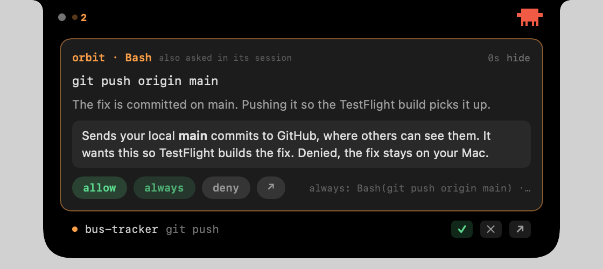
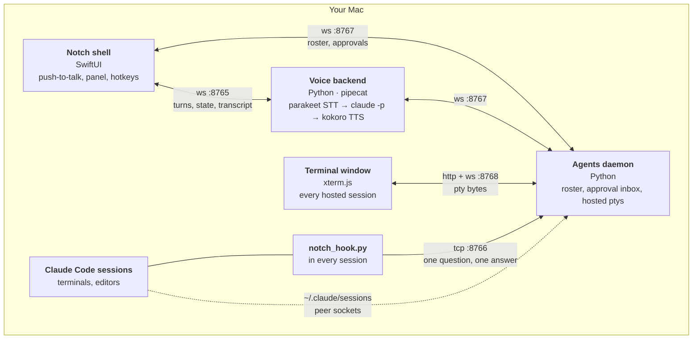
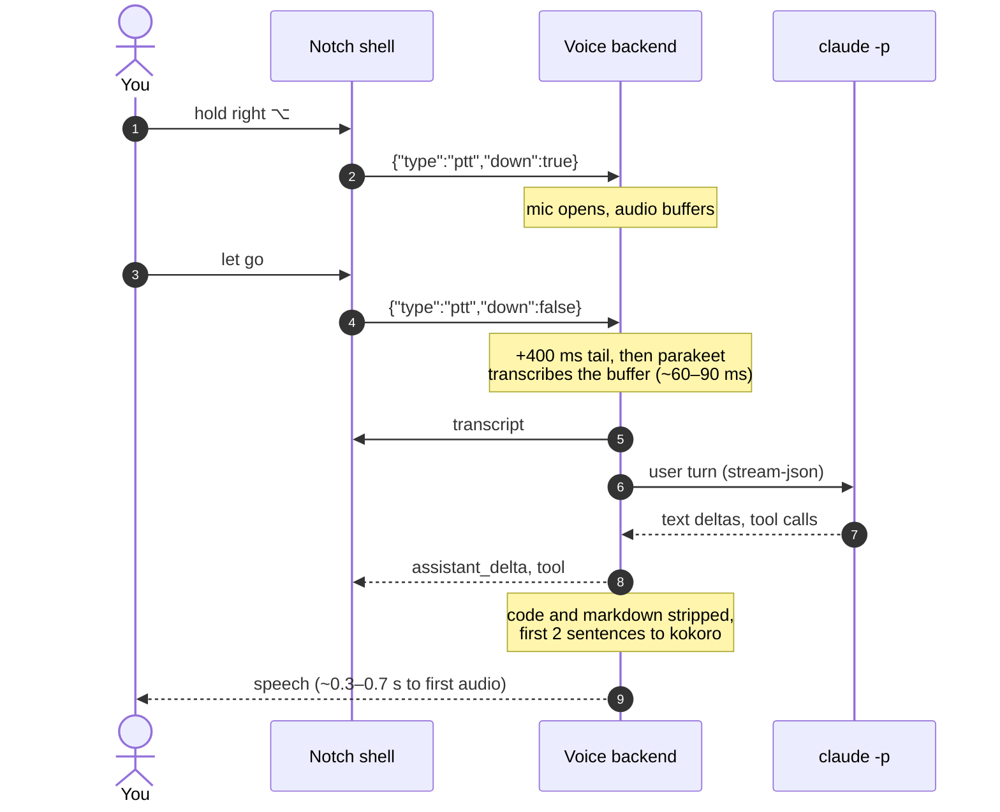
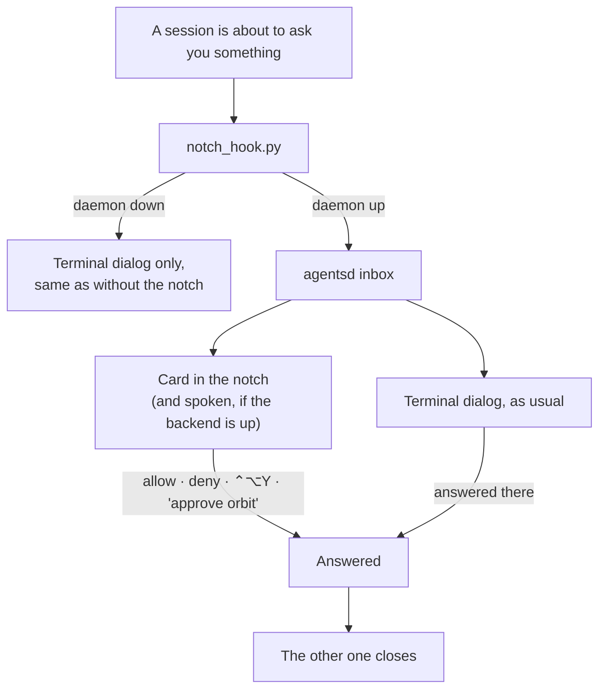

# voice-agent

A companion for Claude Code that lives in the MacBook notch. It watches every
Claude Code session on your Mac, the desktop app's included, and brings what
needs you to where you are: permission questions you can answer, or ask about,
without switching apps; each session's conversation; a line when a long turn
finishes; and replies you can type straight from the notch.

> **Voice is paused.** This started as a voice agent, and the speech code is still
> here: on-device speech-to-text and text-to-speech, push-to-talk. It's off by
> default and not maintained for now. The sections on talking to it and on speech
> describe it as it was; `"voice": true` in `settings.json` turns it back on.

<p align="center">
  
</p>

- [What it does](#what-it-does)
- [How it fits together](#how-it-fits-together)
- [Requirements](#requirements)
- [Install](#install)
- [Run](#run)
- [Talking to it](#talking-to-it)
- [Every agent, in the notch](#every-agent-in-the-notch)
- [Every permission prompt, in one place](#every-permission-prompt-in-one-place)
- [Speech, on-device](#speech-on-device)
- [Configuration](#configuration)
- [Development](#development)
- [WebSocket protocol](#websocket-protocol)
- [Layout](#layout)

## What it does

- **Answer permission questions from the notch.** A question from any session
  drops down by itself with the command, what the agent said about why, and
  allow, always (showing the exact rule it adds), deny, or open in the app. The
  session's own dialog closes when you answer. **why?** asks Haiku to explain
  what the call does while the question stays open.
- **Answer Claude's multiple-choice questions** the same way, with a button per
  option.
- **See every session's conversation.** Sessions sit in a sidebar, grouped by
  what needs you first, with the desktop app's own titles. Pick one to read its
  chat so far, rendered as markdown.
- **Reply from the notch.** ⌃⌥T from any app, or the line under the chat. A
  reply reaches a session as a message from another session, not as you, so it
  can't approve anything on your behalf.
- **Know when a long turn ends**, with the first line of what it said.
- **Let sessions show and ask things.** `notch_ask` puts a small form in the
  notch and waits for your answers; `notch_show` puts up progress, a table or a
  diff.
- **Stay out of the way.** Folded while you're in the Claude app, hidden while
  it isn't running, on the MacBook's display whatever else is plugged in.

## How it fits together



Three processes, each on its own port, so any one can die without taking the
others with it:

| Process | Port | Needs | What it does |
|---|---|---|---|
| **Notch shell** (`shell/NotchAgent`) | — | Accessibility | The notch panel, approval cards, hotkeys, push-to-talk |
| **Voice backend** (`python -m backend.main`) | ws :8765 | `claude` on PATH | Mic, speech to text, the voice agent, text to speech, spoken commands |
| **Agents daemon** (`python -m agentsd`) | ws :8767, tcp :8766, http :8768 | `claude` on PATH | Lists every Claude Code session, holds every open permission question, runs hosted sessions in its ptys and serves the terminal window |

The daemon and the shell work without the voice backend: you still get cards,
clicks and hotkeys, just nothing spoken.

A spoken turn, end to end:



## Requirements

- macOS 14+, on a MacBook with a notch (it works without one, as a pill at the
  top of the screen).
- [Claude Code](https://code.claude.com) on PATH and logged in. The Claude
  desktop app is optional: its Code tabs run Claude Code, so the notch sees them
  the same way.
- Python 3.11+ (pyenv 3.11.6 is what it's built on).
- Xcode command line tools, to build the notch (`xcode-select --install`).

## Install

```bash
git clone https://github.com/bl0opy/voice-agent.git && cd voice-agent
scripts/install.sh
```

There's nothing to install inside the Claude app. The notch hooks into Claude
Code, which every session runs, whether it's in a terminal, an editor or a Code
tab in the app. `install.sh` sets up four things, each also a script of its own:

| Script | What it does | Undo |
|---|---|---|
| `install-hooks.sh` | Adds the notch's hook to `~/.claude/settings.json`, so every session's permission questions also come to the notch, and keeps the notch's token out of the sandbox | `install-hooks.sh --uninstall` |
| `install-agentsd.sh` | Runs the agents daemon at login: it watches the sessions and holds the questions | `launchctl bootout gui/$(id -u)/com.notchagent.agentsd` |
| `install-notch.sh` | Builds the notch and runs it at login, showing while the Claude app is open. Installs the daemon if it isn't yet | `launchctl bootout gui/$(id -u)/com.notchagent.notch` |
| `install-mcp.sh` | Gives every session `notch_ask` and `notch_show`, and allows them without a prompt | `install-mcp.sh --uninstall` |

Sessions already open pick up the hook straight away, and the two tools when
they restart. Read [Security](#security) first: the hook sees every session's
permission questions.

**Permissions.** System Settings → Privacy & Security → **Accessibility**: allow
NotchAgent for ⌃⌥T and ⌃⌥Y / N / J. If you cloned into Documents, macOS also
asks for python3 and NotchAgent to read it; allow both, or the daemon waits on
the prompt.

**Voice** is paused, but still here: `.venv/bin/pip install -r
requirements-voice.txt`, set `"voice": true` in `settings.json`, and use
`./run.sh`. It needs Apple Silicon and about 1.6 GB for the speech models.

## Run

```bash
./run.sh
```

That builds the shell, starts the agents daemon (unless launchd already runs
it), the voice backend (unless voice is off), and the notch. Ctrl-C, or quitting the notch by
right-clicking it, stops everything it started. If the repo has moved, `run.sh`
clears SwiftPM's stale cache and builds again.

Pieces on their own:

```bash
.venv/bin/python -m backend.main               # voice backend only
.venv/bin/python -m agentsd                    # agents daemon only
.venv/bin/python -m agentsd --once             # print one roster snapshot and exit
shell/NotchAgent/.build/release/NotchAgent     # notch only (build with swift build -c release)
```

## Talking to it

Hold **right ⌥** to talk, let go when you're done. The mic is shut the rest of
the time. It's a global monitor, so it works in whatever app is frontmost, and
nothing on macOS binds right ⌥ on its own, so it never doubles as a shortcut.
Holding it while Claude is talking cuts it off.

**The key ends the turn, not the silence.** Pausing to think mid-sentence doesn't
send half a question. The turn is sent when you let go, plus `PTT_TAIL_MS` (400)
for the words that arrive after the key is already up.

**Talking again steers it.** While it's still working, a new turn interrupts the
one in flight and goes in its place. A session running in a terminal can't be
interrupted from outside, so words for a busy one are held and delivered when it
frees up, and dropped after two minutes rather than held forever.

**It speaks briefly and shows everything.** At most two sentences per turn are
spoken (`SPOKEN_SENTENCES`); the notch shows the full answer. Code, diffs and
markdown are stripped from anything spoken. Permission questions are spoken as
"orbit wants to push to git"; the command itself stays on screen.

Other keys, from any app:

| Key | Does |
|---|---|
| right ⌥ (hold) | Talk |
| ⌃⌥T | Type to the focused agent |
| ⌥Space | Interrupt the focused agent |
| ⌃⌥Y / ⌃⌥N | Allow / deny the oldest permission question |
| ⌃⌥J | Bring the terminal that question came from to the front |

Pick a different talk key in Settings (right-click the notch), or with `PTT_KEY` in the
environment `run.sh` starts from: `rightOption` (default), `rightCommand`,
`fn`, `leftOption`, `command`. `command` has to be held alone for 200 ms and any
other key cancels it, since ⌘ is half of every shortcut. `PUSH_TO_TALK=0` gives
the old always-on mic.

### Typing to it

⌃⌥T from any app, or a click on the line under the chat, and
type. The notch holds the keyboard until you press esc, then hands it back to
the app you were in.

- **↩** sends. A hosted session gets it typed into its prompt, as if you'd
  typed it in the terminal window, so a busy one queues it the way Claude Code
  does. A session in a terminal gets it over its peer socket once it's idle.
- **⌘↩** steers: a hosted session's turn is cut short first, then the line goes
  in its place — the same as talking over it.

It goes to the session open in the panel. Under the field it says what happened: sent, held until it's free,
or waiting on a permission question you have to answer first.

With `"voice": false`, that's the whole input: `run.sh` doesn't start the
voice backend, there's no mic and no speech models, and nothing needs Apple
Silicon. Everything else — the roster, approval cards, the supervisor's lines
in the notch — works the same.

### The notch

It behaves like a Dynamic Island. After 5 minutes with nothing working, waiting or
talking (`notch_fold_after` in `settings.json`), it folds into the hardware
notch and disappears. Anything starting up
brings it back as a small pill: status on the left, Claw'd on the right. Hover
it (or the bare notch) and it springs open into the panel. It stays open under
the cursor, while the talk key is held, and after you talk until a few seconds
past the reply, so you can read it; move over it and away to close it sooner.

Claw'd shows the mood of the whole fleet: he hops while anything is working,
paces while something waits on you, stands still and looks up while the mic is
open, bobs while talking, and otherwise blinks, glances around and shuffles,
falling asleep (grey, the odd z) after 45 s of quiet.

## Every agent, in the notch

Hover the notch and it opens into the panel: sessions down the left, the one
you picked on the right. The sidebar groups them by what wants you: **needs
you** (a question, or something the app says it needs), **finished** (a turn you
haven't looked at since it ended, with a green dot), **working**, then **idle**.
Each time the panel opens it starts on whatever needs you most, and while it's
open it stays on the session you're reading, so a reply can't go to one that
just became urgent.

The right side is that session's conversation, read from its transcript every
couple of seconds while the panel is open: what you said, what Claude said, and a
dim line per tool call. For a Code tab in the Claude app, the line above it shows
the app's summary of the last turn, and **open in app ↗** jumps to it.

### Starting agents from the notch (optional)

Off by default: the notch watches the sessions you already run. Turn on "start
agents from the notch" in Settings (`"hosted_agents": true`) and a **+** in the
sidebar opens a path field, and the agents daemon starts the real interactive
`claude` in a pty of its own, drawn in a terminal window of the notch's.

The field starts with `default_agent_path` from `settings.json`, and the
folders that finish what you've typed sit under it: click one, or tab for the
first. A bare name like `bus-tracker` is taken relative to the default. The
sessions belong to the daemon, not the window, and **resume** brings one back
with `claude --resume` after a restart. A pty socket is a keyboard on a live
session, so the daemon wants its token and its own page's `Origin` on every one.

`settings.json` is yours and gitignored; `run.sh` copies it from
`settings.example.json` the first time.

### Hosted, owned and terminal agents

| | Hosted by the daemon | The voice agent | Started in a terminal |
|---|---|---|---|
| Listed, with live state and tokens | yes | yes | yes |
| Focus it, talk to it, hear it back | yes | yes | yes |
| Type to it directly | the terminal window | — | its terminal |
| Interrupt | yes | yes | no — `stop` reads `can't stop` |
| Approve or deny from the notch, by voice or key | yes, with `install-hooks.sh` | yes | yes, with `install-hooks.sh` |

Talking to a terminal session goes over the peer socket Claude Code already
serves (`/tmp/cc-socks/<pid>.sock`, authenticated with that session's own key
file), and its answer is read back from its transcript. If it's mid-turn the
words are held and delivered the moment it's free, so nothing lands as a dialog
in a window you aren't looking at.

Both are undocumented surfaces (`~/.claude/sessions/` and the peer socket),
verified against Claude Code 2.1.273. When either changes, rows degrade to
`unknown` and the roster keeps working rather than the daemon crashing.

## A supervisor for the rest

The agent you're focused on is a conversation. Every other working agent is
watched by a supervisor in the agents daemon that reads its transcript and never
touches it: no typing, no approvals, no interrupts.

It says something in two cases, out loud and as a popup under the notch's pill
(click it to open that agent):

- **Progress**, on a long turn: after 3 minutes and every 5 after.
  *"pose-lab, 7 minutes in, 12 edits across 4 files, tests passing. Now wiring
  the eval loop into the CLI."*
- **Stuck**, the moment one looks it. Judged by rule, no model:

  | Rule | When |
  |---|---|
  | failing | the same call has failed 3 times this turn |
  | looping | the same call 4 times in its last 12, no edits between |
  | hung | one call running 5 minutes (a dev server in the foreground, a prompt waiting on stdin) |
  | silent | working, nothing written for 5 minutes |
  | churning | the same file edited 8 times this turn |

  The rule decides *that* it's stuck. *Why* comes from one short Haiku call
  through your own `claude`: no tools, no settings, no MCP, no session saved, run
  in an empty folder, with the agent's recent calls and errors as its only input.
  No API key; it counts against your plan like any other call.
  *"pose-lab looks stuck: it keeps rerunning the same test without fixing the
  missing import it trips on."* With `SUPERVISOR_EXPLAIN=off` it says the rule's
  own sentence instead.

Each reason is said once per turn; a new prompt starts a clean slate. Nothing
is said about the agent you're focused on, and nothing is spoken over you or
over an answer.

## Every permission prompt, in one place

`scripts/install-hooks.sh` adds one hook to `~/.claude/settings.json` (a copy of
`hooks/notch_hook.py` in `~/.claude/hooks`, run by the system python, so it
survives the repo moving). It applies to every Claude Code session, including
ones already running. `--uninstall` takes it out; the file is backed up to
`settings.json.bak-notch` either way.



The notch opens by itself for a new question, oldest first: the project, the
exact command or path, and **allow** / **always** / **deny** / **↗**. Anything
else waiting sits underneath as one line with ✓ ✕. **hide** closes the panel
until the next new question; the amber count stays on the collapsed notch.

### Spoken commands

These are matched before anything goes to the agent, so they're instant:

| Say | Does |
|---|---|
| "yes", "go ahead" / "no", "nope" | Answers the oldest question |
| "approve orbit", "deny bus tracker" | Answers that project's question |
| "always allow orbit" | Allow, and keep the rule Claude Code suggested |
| "what's waiting" | One sentence: who's asking what, who's working |
| "what's this costing", "context usage" | The whole fleet: tokens, dollars, fullest window |
| "go to descant", "back" | Hand an agent the mic, or return it to the voice agent |
| "stop orbit" | Interrupt it, if the notch started it |

A bare "yes" won't pass a destructive command (`rm -rf`, `git push`,
`reset --hard`, `sudo`, package installs…). The notch says "that one wants to
push to git — say approve orbit" and waits for the name. Four words or fewer
counts as a bare answer, so "ok but first rename it" still goes to the agent.

Out loud you hear "orbit wants to push to git" when a question arrives and
"orbit is done" when a turn of 30 s or more finishes somewhere you aren't
focused. The notch shows the same turn ending as a line ("done after 5
minutes"), and with voice off a system sound stands in for the voice — for new
questions and stuck agents too (`sounds` in settings.json). A turn's end is
seen from the roster going from working to idle, so it works for every
session, hook or not; where the Stop hook is installed it's heard a tick
sooner, and the two are told once. Several at once are said together, never while you're holding the key
or it's already talking, and a question answered before it gets a word in isn't
said at all.

### Owned agents' approvals

Agents the notch starts run in `CLAUDE_PERMISSION_MODE` (default `auto`), with no
dialog of their own. The hook, given to them as a `PreToolUse` hook, sends the
risky minority (`rm -rf`, `sudo`, `git push` / `reset --hard`, package installs,
writes outside the project, `WebFetch`) to the same inbox and lets everything
else through, so auto mode stays quiet. There's nowhere else to answer those, so
they fail closed: no answer in `APPROVAL_TIMEOUT_S` (180), or no daemon at all,
is a deny.

Edit `RISKY_BASH` in `hooks/notch_hook.py` and `agentsd/risk.py` together to
change what gets gated.

The hook can *veto* a tool call, but a hook `allow` does not override Claude
Code's own refusals: approving something the CLI itself refuses in headless mode
(`rm -rf`, for one) still won't run it. Claude Code keeps the final say.

> **No cards showing up?** If `~/.claude/settings.json` sets
> `permissions.defaultMode` to `auto`, Claude Code runs most commands without
> asking, so there's nothing to show. `claude --permission-mode default` (or
> shift+tab in a running session) brings the prompts back.

## Speech, on-device

### In: parakeet

Speech is transcribed on the machine with
[parakeet-mlx](https://github.com/senstella/parakeet-mlx). The model (~1.2 GB)
downloads itself on first run and loads in about 1.6 s at startup.

Push-to-talk is what makes a local model work here. A streaming cloud model
earns its keep by deciding *when* a turn ended from the audio; with hold-to-talk
the key already says so, so the local model only has to transcribe a bounded
buffer on release. Measured on an M1 Max with `parakeet-tdt-0.6b-v3`:

| Audio | Key-up to text |
|---|---|
| 0.7 s — "what's waiting" | 57 ms |
| 2.4 s — a short sentence | 78 ms |
| 3.4 s — a long one | 86 ms |

It mishears names it has never seen ("descant" comes back as "desk and"), which
matters because spoken commands are addressed by project. `backend/vocab.py`
puts them back by matching runs of words against the repos that currently have
sessions. The threshold is set from measured pairs, so "the agent" is left alone
but "bus trucker" becomes `bus-tracker`.

### Out: Kokoro

Replies are spoken by [Kokoro-82M](https://huggingface.co/hexgrad/Kokoro-82M)
through kokoro-onnx, which pipecat already wraps. The model (~350 MB) downloads
on first run; `KOKORO_VOICE` picks the voice (`af_heart` by default).

It renders a whole sentence before any of it plays, so what you wait for is the
first sentence of a reply. Later sentences render while earlier ones play, about
4x faster than realtime. Measured on an M1 Max:

| Sentence | First audio |
|---|---|
| "Done." | 269 ms |
| "Orbit wants to push to git." | 432 ms |
| "The notch should reconnect on its own within a few seconds." | 709 ms |

CoreML makes no difference, and the MLX build of Kokoro needs espeak data it
couldn't find, so the ONNX one is the default.

### Deepgram, if you want it

`STT_BACKEND=deepgram` switches to Deepgram Flux (the better transcriber) and
`TTS_BACKEND=deepgram` to Aura-2 (starts a little sooner, sounds a little
better). Both share one `DEEPGRAM_API_KEY`. Without parakeet or kokoro-onnx
installed, the backend falls back to Deepgram on its own.

## Configuration

Two files, both optional and both gitignored:

- **`settings.json`** — the notch's settings, edited in Settings (right-click the notch) or
  by hand:

  | Key | Default | |
  |---|---|---|
  | `voice` | `true` | `false`: typing only, no voice backend. Read at launch |
  | `talk_key` | `rightOption` | The push-to-talk key; `PTT_KEY` overrides it |
  | `default_agent_path` | `~` | Where new agents start; bare names are relative to it |
  | `notch_fold_after` | `300` | Seconds of quiet before the pill folds away; 0 keeps it up |
  | `sounds` | on when voice is off | A system sound for new questions, stuck agents and long turns ending |
- **`.env`** — the backend's and daemon's environment. Anything below can also
  be set in the shell environment instead.

### Speech

| Variable | Default | |
|---|---|---|
| `STT_BACKEND` | `local` | `local` (parakeet) or `deepgram` |
| `TTS_BACKEND` | `kokoro` | `kokoro` or `deepgram` |
| `PARAKEET_MODEL` | `mlx-community/parakeet-tdt-0.6b-v3` | |
| `KOKORO_VOICE` | `af_heart` | |
| `DEEPGRAM_API_KEY` | — | Only needed for a Deepgram backend |
| `DEEPGRAM_MODEL` | `flux-general-en` | |
| `DEEPGRAM_VOICE` | `aura-2-thalia-en` | |
| `EOT_THRESHOLD` / `EOT_TIMEOUT_MS` | `0.7` / `1500` | Flux end-of-turn tuning, without push-to-talk |

### Claude

| Variable | Default | |
|---|---|---|
| `CLAUDE_MODEL` | `claude-sonnet-5` | Empty uses the CLI's own default |
| `CLAUDE_PERMISSION_MODE` | `auto` | For agents the notch starts |
| `CLAUDE_CWD` | where the backend started | The voice agent's own working directory |
| `CANCEL_ON_INTERRUPT` | `1` | Interrupting also cancels the in-flight turn |
| `APPROVAL_TIMEOUT_S` | `180` | Unanswered owned-agent question becomes a deny |

### Talking

| Variable | Default | |
|---|---|---|
| `PUSH_TO_TALK` | `1` | `0` for an always-on mic |
| `PTT_KEY` | `rightOption` | Read by the shell, not the backend; overrides `talk_key` |
| `PTT_TAIL_MS` | `400` | How long after key-up the turn is sealed |
| `SPOKEN_SENTENCES` | `2` | The notch shows everything regardless |
| `MIC_GATE` | `1` | Hold the mic shut while it talks; `0` on headphones |
| `MIC_GATE_TAIL_MS` | `250` | |

### Audio

| Variable | Default | |
|---|---|---|
| `AUDIO_IN_DEVICE` / `AUDIO_OUT_DEVICE` | built-in | Name substring or pyaudio index |
| `AUDIO_SAMPLE_RATE` | `48000` | One rate for mic, speakers and pipeline |
| `TTS_SAMPLE_RATE` | `24000` | Render native, resample locally |

Left empty, the devices pin the MacBook's built-in mic and speakers by name, so
a connected interface never gets picked up just because it's the system default.
The built-in devices are natively 48 kHz, so nothing resamples at the device.
Kokoro and Aura-2 are 24 kHz models, so that step has to happen somewhere:
asking Deepgram for 48 kHz leaves 0.17% of the energy above 12 kHz (imaging
junk, which reads as harsh); pipecat's soxr VHQ leaves none.

The built-in mic hears the built-in speakers (3.5x room noise at moderate
volume) and there's no echo canceller, which is why `MIC_GATE` is on by default.
With push-to-talk the gate is redundant anyway.

### Supervisor

| Variable | Default | |
|---|---|---|
| `SUPERVISOR_EXPLAIN` | `claude` | `off` skips the Haiku call and says the rule's sentence |
| `SUPERVISOR_DIGEST_AFTER_S` | `180` | First progress line on a long turn |
| `SUPERVISOR_DIGEST_EVERY_S` | `300` | Then one this often |
| `SUPERVISOR_HUNG_S` | `300` | One call running this long is stuck |
| `SUPERVISOR_SILENT_S` | `300` | No transcript activity this long is stuck |
| `SUPERVISOR_SPEAK_PROGRESS` | `1` | `0` shows progress in the notch without saying it |

### Ports and daemon

| Variable | Default | |
|---|---|---|
| `WS_HOST` / `WS_PORT` | `127.0.0.1` / `8765` | Backend ↔ shell |
| `AGENTS_URL` | `ws://127.0.0.1:8767` | Where the backend finds the daemon |
| `AGENTS_WS_PORT` | `8767` | Daemon ↔ shell and backend |
| `NOTCH_INBOX_PORT` | `8766` | Hook → daemon |
| `AGENTS_WINDOW_PORT` | `8768` | The terminal window's page and pty sockets |
| `AGENTS_TICK_S` | `1.0` | Roster refresh |
| `AGENTS_SEND_DETAILS` | `1` | `0` keeps prompt text and tool arguments off the socket |
| `NOTCH_TERMINAL_WAIT_S` | `590` | How long a terminal session's question stays in the notch |

## Development

Mock backends, so the shell can be worked on without a mic, models or agents:

```bash
.venv/bin/python scripts/mock_bridge.py                     # fake voice backend on :8765
.venv/bin/python scripts/mock_agents.py                     # fake roster and questions on :8767
MOCK_SCENE=cycle .venv/bin/python scripts/mock_agents.py    # questions → working → idle every 40 s
MOCK_SCENE=supervisor .venv/bin/python scripts/mock_agents.py  # the supervisor's popups
MOCK_SCENE=notify .venv/bin/python scripts/mock_agents.py   # done, new question, stuck, short done, every 8 s
```

The mock daemon also answers typed lines (`typed`) and `+ agent` (a new hosted
row), so the compose field and the inline path field can be tried against it.

The notch's own tests, and renders of each of its states:

```bash
cd shell/NotchAgent && swift test                               # approvals, notices, island modes, typing, new agents
SNAPSHOT_DIR=/tmp/notch swift test --filter SnapshotTests       # PNGs of the pill, notices, cards, focus, agents
```

The screenshots above are the real shell against these two.

Smoke tests, no audio or API keys needed:

```bash
.venv/bin/python scripts/stt_smoke.py         # local STT: synthesised speech in, corrected text out, timed
.venv/bin/python scripts/tts_smoke.py out.wav # local TTS: time to first audio per sentence
.venv/bin/python scripts/commands_smoke.py    # spoken command grammar
.venv/bin/python scripts/inbox_smoke.py       # the inbox with the real hook: concurrency, fallbacks
.venv/bin/python scripts/fleet_smoke.py       # voice answering questions end to end
.venv/bin/python scripts/director_smoke.py    # focus routing, owned and foreign
.venv/bin/python scripts/peer_smoke.py        # a foreign session can be messaged and heard
.venv/bin/python scripts/tail_smoke.py        # a foreign agent's answer is what gets spoken
.venv/bin/python scripts/window_smoke.py      # hosted ptys: typing, resize, replay, exit, origin check
.venv/bin/python scripts/supervisor_smoke.py  # every stuck rule, progress lines, dedupe (--live asks Haiku why)
.venv/bin/python scripts/turns_smoke.py       # a turn's end from the roster and the Stop hook, said once
.venv/bin/python scripts/type_smoke.py        # typing to a terminal session through the daemon, no voice
```

The manual test checklist and troubleshooting table are in [SETUP.md](SETUP.md).

## WebSocket protocol

Backend → shell (`ws://127.0.0.1:8765`):

```json
{"type": "state",           "value": "idle|listening|thinking|speaking|error"}
{"type": "transcript",      "role": "user", "text": "...", "final": true}
{"type": "assistant_delta", "text": "..."}
{"type": "assistant_done",  "text": "<full raw turn>"}
{"type": "tool",            "id": "...", "name": "Edit", "summary": "editing", "detail": "..."}
{"type": "tool_result",     "id": "...", "ok": true, "text": "..."}
{"type": "mic",             "open": true}
{"type": "session",         "id": "...", "cwd": "..."}
{"type": "focus",           "id": "<session id>"}
{"type": "owned",           "ids": ["..."]}
{"type": "delivery",        "id": "...", "status": "queued|delivered|refused"}
{"type": "error",           "message": "..."}
```

Shell → backend:

```json
{"type": "interrupt",   "id": "<optional session id — a row's stop button>"}
{"type": "text",        "text": "typed turn, same path as a spoken one"}
{"type": "say",         "text": "speak this verbatim"}
{"type": "ptt",         "down": true}
{"type": "focus",       "id": "<session id>"}
{"type": "hello"}
```

`hello` is sent on every connect; the backend replies with the owned ids, focus
and cwd so a reconnected shell doesn't show stale state.

Agents daemon (`ws://127.0.0.1:8767`) → shell and backend:

```json
{"type": "agents",      "list": [{"id": "...", "project": "...", "state": "waiting", "tty": "ttys003", "host": "Terminal", "...": "..."}]}
{"type": "approvals",   "list": [{"id": "...", "source": "terminal|owned", "sessionId": "...", "pid": 123,
                                  "project": "orbit", "tool": "Bash", "detail": "git push", "summary": "push to git",
                                  "risky": true, "canAlways": false, "created": 1789578000000}]}
{"type": "fleet_event", "event": "done", "sessionId": "...", "project": "orbit", "long": true}
{"type": "fleet_event", "event": "progress|stuck", "sessionId": "...", "project": "orbit", "line": "...",
                        "reason": "failing|looping|hung|silent|churning", "level": "info|attention", "speak": true}
{"type": "hosted",      "list": [{"id": "...", "cwd": "...", "pid": 123, "running": true, "exitCode": null, "startedAt": 1789578000000}]}
{"type": "spawned",     "id": "...", "cwd": "..."}
{"type": "typed",       "id": "...", "status": "sent|steered|queued|waiting|gone|refused", "detail": "..."}
{"type": "error",       "message": "..."}
```

Shell, backend or window → agents daemon:

```json
{"type": "approve",   "id": "...", "approved": true, "always": false, "how": "from the notch"}
{"type": "spawn",     "cwd": "/path/to/a/repo"}
{"type": "resume",    "id": "<hosted session id>"}
{"type": "type",      "id": "...", "text": "a line for it", "steer": true}   // any session; steer only cuts in on hosted ones
{"type": "interrupt", "id": "..."}
{"type": "stop",      "id": "..."}
{"type": "forget",    "id": "..."}
```

The terminal window's page opens `ws://127.0.0.1:8768/pty/<id>` per session:
`{"type": "replay|out", "data": "..."}` and `{"type": "exit", "code": 0}` come
back, `{"type": "in", "data": "..."}` and `{"type": "resize", "cols", "rows"}` go in.

The hook talks to the daemon on `127.0.0.1:8766`: one JSON line describing the
call, one line back: `{"decision": "allow|deny|none", "reason": "...", "permissions": [...]}`.

## Layout

| Path | What |
|---|---|
| `run.sh` | Builds the shell, starts everything, stops it all on exit |
| `settings.example.json` | Template for `settings.json` |
| `requirements.txt` | The daemon and the notch: all that typing only needs |
| `requirements-voice.txt` | Adds the voice backend: pipecat, parakeet, Kokoro |
| **`backend/`** | **Voice backend** |
| `backend/main.py` | Pipecat pipeline wiring, shell message handlers |
| `backend/config.py` | Every environment variable and its default |
| `backend/claude_code.py` | Long-lived `claude -p` subprocess, stream-json in and out |
| `backend/processor.py` | Sits where an LLM service would; drives Claude Code, feeds TTS |
| `backend/agents.py` | Who has focus; routes a spoken turn to the right agent |
| `backend/commands.py` | Spoken fleet commands: approve, deny, status, go to, stop |
| `backend/fleet.py` | The backend's link to the agents daemon |
| `backend/stt.py` | On-device speech recognition, segmented by the talk key |
| `backend/vocab.py` | Puts back project names a local model mishears |
| `backend/speech.py` | Strips code, diffs and markdown before anything is spoken |
| `backend/ptt.py` | Push-to-talk gate: silences the mic unless the key is held |
| `backend/mic_gate.py` | Holds the mic shut while it talks |
| `backend/bridge.py` | WebSocket server the shell talks to |
| **`agentsd/`** | **Agents daemon** |
| `agentsd/registry.py` | Every Claude Code session on the machine |
| `agentsd/inbox.py` | Every open permission question, held until it's answered somewhere |
| `agentsd/peer.py` | Talks to terminal sessions over their peer socket |
| `agentsd/risk.py` | What a tool call is in words, and which ones are destructive |
| `agentsd/usage.py` | Tokens, what they'd cost at API rates, how full a window is |
| `agentsd/supervisor.py` | Watches unfocused agents: progress lines, stuck rules, the Haiku explainer |
| `agentsd/pty_host.py` | Runs hosted sessions in ptys the daemon owns |
| `agentsd/turns.py` | When a turn ends: the roster and the Stop hook, told once |
| `agentsd/window.py` | Serves the terminal window's page and a socket per pty |
| **`window/`** | **The terminal window's page (xterm.js vendored under `vendor/`)** |
| **`hooks/`** | |
| `hooks/notch_hook.py` | The one hook: PermissionRequest, PreToolUse (owned agents), Stop |
| **`shell/NotchAgent/`** | **SwiftUI app (SPM executable)** |
| `.../NotchView.swift` | The panel: the session sidebar, chat, question cards |
| `.../PushToTalk.swift` | Global key watcher: right ⌥ opens the mic |
| `.../AgentPath.swift` | Resolves and completes the path for a hosted agent |
| `.../Settings.swift` | Reads and writes `settings.json`; the ports |
| `.../SettingsWindow.swift` | Settings, from the notch's right-click menu |
| `.../Jump.swift` | Brings a session's terminal to the front |
| `.../TerminalWindow.swift` | Native window around the terminal page |
| **`scripts/`** | Installers, mocks and smoke tests (see [Development](#development)) |
| `service/` | launchd plist for the agents daemon |

## Security

The notch can answer Claude Code's permission questions, so read this before you
install it.

- **It sees every session's permission questions.** `scripts/install-hooks.sh`
  adds a `PermissionRequest` hook to `~/.claude/settings.json`, which applies to
  every Claude Code session on your Mac, the desktop app's included. With the
  agents daemon down the hook does nothing, and each session asks as it would
  have anyway. `--uninstall` takes it out.
- **Its sockets take a token.** The daemon listens on localhost only, but any
  process on your Mac can reach localhost, a sandboxed command an agent ran
  without asking included. So every connection must show the token in
  `~/Library/Application Support/notch-agent/bridge-token`, a file only you can
  read. `install-hooks.sh` also adds that file to
  `sandbox.filesystem.denyRead`, since Claude Code's sandbox otherwise lets a
  command read most of your home folder. Without that, a sandboxed command could
  read the token and answer its own permission questions. Check it's there if
  you manage that file by hand.
- **Sessions can't do more through it.** A message typed in the notch reaches a
  session as one "from another Claude session", which Claude won't treat as you
  approving anything. A card a session puts up with `notch_ask` or `notch_show`
  is one of a fixed set of shapes, not interface code, and its answer goes back
  only to that session.
- **"Why?" sends a little to Haiku.** Asking why on a question hands the command
  and the last few lines of that conversation to Haiku through your own
  `claude`, with no tools, and shows what it says. It's a second opinion, not a
  safety check.
- **It reads Claude Code's internals.** The session registry, transcripts, peer
  key files and the desktop app's session files aren't documented or promised
  to stay the same. An update can break parts of the notch; it's experimental.

## License

[MIT](LICENSE).

An independent project, not affiliated with or endorsed by Anthropic. Claude,
Claude Code and Claw'd are Anthropic's.
